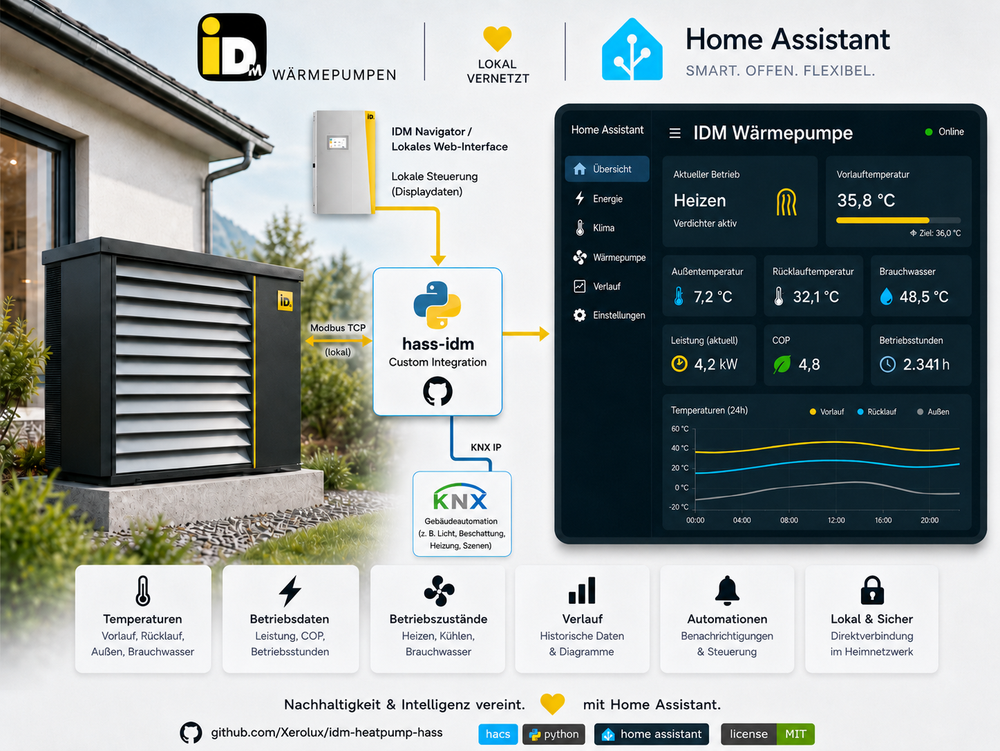
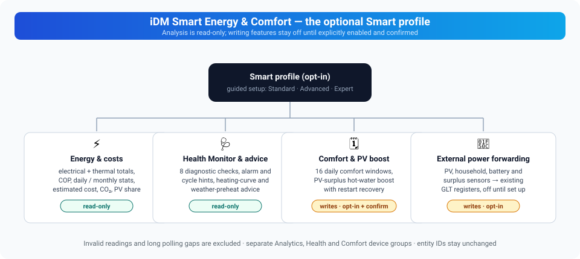
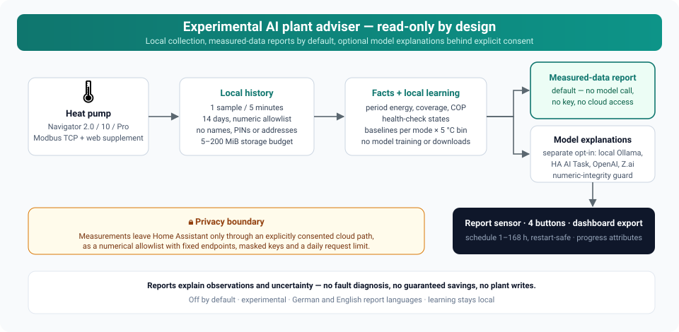

# IDM Heatpump - Home Assistant Integration

   
  <small><i>AI generated</i></small>

> **The complete documentation** for the IDM Heatpump integration.
> From installation to troubleshooting — with all features, entities, and services.

> **For Modbus operation:** Modbus TCP must be enabled on the IDM
> Navigator/controller under **Building management system
> (Gebäudeleittechnik) → Modbus TCP → On (Ein)**. See
> [Installation & Setup](Installation-and-Setup#enable-modbus-tcp-on-the-idm-heat-pump).

---

## What is the IDM Heatpump Integration?

The **IDM Heatpump Home Assistant Integration** connects [Home Assistant](https://www.home-assistant.io/) with IDM Navigator controllers by IDM EnergieSysteme GmbH. It enables local monitoring and supported controls via **Modbus TCP — no cloud, no subscription**. Navigator 10 has direct hardware confirmation; Navigator 2.0 and Navigator Pro remain under broader compatibility validation.

| Feature | Details |
|---------|---------|
| **Protocol** | Modbus TCP (Port 502, Slave ID 1) |
| **Optional supplement** | Local Navigator web API; PIN required for web access, supported controls in Navigator 10/Pro `web_only` mode |
| **Documentation version** | `0.26.11` source tree; [latest stable release](https://github.com/Xerolux/idm-heatpump-hass/releases/latest) |
| **Supported/tested HA baseline** | 2026.11.0 |
| **Python** | 3.14+ (managed by Home Assistant) |
| **Connection library** | modbus-connection>=4.12.7 |
| **Socket backend** | tmodbus[async-serial]>=0.6.2 |
| **Device/web library** | idm-heatpump-api[web]==2.16.2 |
| **License** | MIT |
| **Languages** | DE, EN; setup and action interfaces also ES, IT, RO, CS, PL |
| **Entities** | Model- and configuration-dependent sensors, binary sensors, numbers, selects, switches, climate, water heater, and buttons |

---

## Core Features

### Which dependency version belongs to an installed release?

This documentation follows the current source tree, which can include
unreleased dependency updates. Its library versions do not describe every
older installed release. The authoritative requirements for an installed
version are in **that release tag's manifest**, not `main`.
For example, [the 0.19.0 manifest](https://github.com/Xerolux/idm-heatpump-hass/blob/v0.19.0/custom_components/idm_heatpump/manifest.json)
pins API version **2.4.3**. A runtime reporting that version on 0.19.0 is correct.
Compare the integration/API version sensor and diagnostics with your tag
before treating a newer version in the current website as an installation error.

CI, release validation and Pages deployment check current version claims
against the checked-out manifest. Dependency automation synchronizes those
claims; published changelogs and release evidence remain unchanged history.

### Current features in the 0.26 series

The current feature overview includes:

| Feature | What you get |
|---------|--------------|
| Setup network scan | Find Modbus TCP endpoints in a selected IPv4 subnet and use a discovered address; manual entry remains available |
| Voluntary plant reports | Separate opt-in for daily plant reports; [Telemetry and privacy](Telemetry) explains data scope, storage and deletion |
| Independent firmware query | Compare installed firmware with community observations; separately enabled, without automatic installation or guaranteed availability |
| PV zero-power workaround | Optionally forward valid 0 W as 10 W when the Navigator otherwise reports message 20300; controller PV displays and statistics may be affected |
| Additional UI languages | Setup, options, actions, repairs and errors in Spanish, Italian, Romanian, Czech and Polish; entity names remain German/English |
| Installer checklist | [Printable preparation](Installer-Checklist) covering Modbus TCP, networking, GLT/PV and web access |

This integration line requires **Home Assistant 2026.11.0 or newer**.
See the [Changelog](Changelog) for changes between individual releases.

### Differential temperature circuits

For circuits configured accordingly in the Navigator, Home Assistant shows
storage and reference temperatures, their signed difference and operating
status. Keep the circuit selected in both the ordinary heating-circuit list
and the differential-circuit list. Ordinary heating controls are hidden for
these circuits; the controller configuration is unchanged.
See [configuration](Configuration#differential-temperature-controlled-circuits)
and [entity mapping and limits](Entities#differential-temperature-controlled-heating-circuits).
Confirmation on differential-control hardware is still pending;
hysteresis and threshold controls are not included.

### Smart Energy, comfort and AI reports

Optional energy analysis, comfort functions and the experimental AI adviser
extend the local controller integration. Automatic controls remain off until
explicitly enabled.

  

| Feature | What you can do | Device writes |
|---------|-----------------|---------------|
| Standard / Advanced / Expert setup | Choose the amount of configuration detail; all three modes offer the same functions | Selecting a mode does not write registers |
| Smart or Vanilla profile | Keep the core controller entities, or add energy and operating analysis with Smart | Analysis is read-only; boost controls write when used |
| Persistent energy statistics | Track electrical and thermal energy, COP, estimated costs, CO₂ and PV use | None |
| PV surplus DHW manager | Start a bounded hot-water boost using selected HA power and optional battery sensors | Optional; off by default, exclusive-control confirmation required |
| Comfort schedules | Apply daily room targets to selected circuits, with up to 16 windows and conditional restore | Optional; off by default, exclusive-control confirmation required |
| Heating and weather advice | Read flow-temperature hints and a six-hour weather recommendation | None |
| Health Monitor and installer report | Inspect eight diagnostic checks, operation history and redacted diagnostics | None |
| External power forwarding | Forward PV, household, battery and surplus sensors to the existing GLT registers | Optional; off until configured |
| Feature device groups | Find Analytics, Health Monitor, Comfort and Diagnostics separately | None; entity IDs remain unchanged |
| **AI plant adviser** *(experimental)* | Daily, weekly, health and efficiency reports from measured facts — by default without any model call; dedicated AI device, four report buttons, dashboard export, restart-safe schedule, local statistical learning with live progress | None; read-only, off by default |
| **Optional model explanations** | Free-form reports via local Ollama, an existing HA AI Task entity, or consented OpenAI/Z.ai — numeric-integrity guard, numerical fact allowlist, daily request limit | None; consent required for cloud paths |

  

Start with [iDM Smart Energy & Comfort](Smart-Energy-and-Comfort) for activation,
examples, defaults and limitations, and with the
[Experimental AI adviser](Experimental-AI-Adviser) for setup, report modes,
privacy and the dashboard.

### Controller integration

- **System Monitoring**: Flow, return, hot water, outdoor temperature, pressure, flow rate
- **Heating Circuits A–G**: Up to 7 heating circuits with individual setpoint and mode control
- **Zone Modules**: Up to 10 zones with up to 8 configurable rooms each; current Navigator 10 hardware defaults to 6 rooms per module.
- **Solar & PV**: Solar hot water heating, PV surplus utilization, battery monitoring
- **Energy Monitoring**: Heat quantity, runtimes, energy meters
- **Cascade & Bivalence**: Multi-heat pump control, heating element integration
- **BMS Remote Maintenance**: BMS temperature requests (cyclic writing)
- **Error Management**: Error detection, error acknowledgment, diagnostics export
- **Optional Web Supplement**: Navigator generation, software version, heat pump model, compact myIDM ID, web-only diagnostics, and Navigator 10 infosystem notifications without replacing Modbus values; default interval 30 seconds
- **KNX Bridge** *(optional)*: Serves the IDM KNX communication objects — same object numbers, datapoint types and directions as IDM's ETS example project — through the Home Assistant KNX integration, so the Weinzierl KNX IP BAOS gateway module is no longer needed. See [KNX Bridge](KNX-Bridge).
- **Room Temperature Forwarding**: Optional forwarding of Home Assistant temperature sensors to IDM external room temperature registers per heating circuit
- **Readable Diagnostics**: Internal IDM messages are shown with text plus structured code/text attributes
- **Direct local Modbus runtime**: `modbus-connection` and tmodbus provide the shared connection or private fallback socket; `idm-heatpump-api` keeps the IDM register and safety logic

---

## Platforms & Entities

| Platform | Entities | Description |
|----------|----------|-------------|
| **Sensor** | model-dependent | Temperatures, pressures, flow rates, energy, PV, solar, cascade, booster, runtime versions |
| **Binary Sensor** | model-dependent | Fault alarms, compressor status, heating/cooling/DHW demand, web states |
| **Number** | model-dependent | Writable setpoints, limits, GLT parameters, power limits |
| **Select** | model-dependent | System mode, circuit modes, solar/ISC mode |
| **Switch** | model-dependent | External heating/cooling/DHW demand |
| **Climate** | per circuit + zone room | Heating/cooling mode + target temperature for heating circuits and zone-module rooms |
| **Water Heater** | 1 | DHW target temperature with current temperature readback |
| **Button** | model- and option-dependent | Acknowledge errors, reload the connection, supported DHW actions and optional AI reports |
| **Conversation** | local agent | Deterministic Assist answers in German and English |

---

## Quick Navigation

### I'm new here
1. [Installation & Setup](Installation-and-Setup)
2. [Configuration](Configuration)
3. [Entities](Entities)

### I want to automate
1. [iDM Smart Energy & Comfort](Smart-Energy-and-Comfort)
2. [Configuration and source mappings](Configuration)
3. [Services Reference](Services)

### Findings and evidence
- [Field findings and documentation maintenance](Findings-and-Documentation)
- [Predictive Advisor](Predictive-Advisor)
- [Telemetry and firmware orientation](Telemetry)

### I have a problem
1. [Troubleshooting](Troubleshooting)
2. [Local Navigator Web Interface](Local-Web-Interface)
3. [Modbus Registers](Modbus-Register)
4. [Stability & Release Readiness](Stability-and-Release-Readiness)

### I want to contribute
- [Contributing Guide](Contributing)

---

## Technical Details

- **Batch reading**: Only exactly adjacent, non-overlapping ranges are grouped, up to 40 Modbus words per request
- **Value validation**: Unavailable sentinels are omitted as unused; suspicious grouped values are checked individually and quarantined for the client session
- **Library-powered**: All registers from [`idm-heatpump`](https://github.com/Xerolux/idm-heatpump-api)
- **Actionable setup diagnostics**: Separate messages for hostname/DNS errors, refused or disabled Modbus TCP, timeouts, unreachable endpoints, wrong slave IDs, invalid web PINs, and unavailable web interfaces
- **Runtime version visibility**: Integration, `idm-heatpump-api`, `modbus-connection` and `tmodbus` versions are available in a diagnostic sensor, diagnostics exports, and startup logs
- **Data types**: FLOAT, UCHAR, INT8, INT16, UINT16, BOOL, BITFLAG
- **EEPROM protection**: Sensitive registers tracked and protected
- **Transport boundary**: Raw FC03/FC04 reads and FC16 writes use the exact `modbus-connection>=4.12.7` / `tmodbus[async-serial]>=0.6.2` pair; `4.12.7` is the connection-library version, not the IDM integration version
- **API boundary**: `idm-heatpump-api[web]==2.16.2` provides batching, decoding and write safety. The API owns its own exception hierarchy; the integration uses the tmodbus-backed socket without a pymodbus dependency
- **Auto-recovery**: API retry/backoff plus reconnect-on-demand in the tmodbus-backed connection
- **Connection ownership**: Each entry uses Home Assistant's shared Modbus connection when available (`owns_socket: false`, `supports_shared_connection: true`), with a private socket fallback when the shared claim cannot be acquired
- **Validation status**: Automated checks and read-only Navigator 10 observations are available; they do not replace candidate-specific clean-install, long-duration and broader model validation. See [Stability & Release Readiness](Stability-and-Release-Readiness).
- **Navigator 10**: Heat sink sensors, flow rate (Sieb monitoring), groundwater temps, booster A/B
- **Web supplement**: Setup tests both supported local protocols when needed, stores the successful Navigator family, reuses its session and retries only that same protocol during normal runtime recovery
- **Room forwarding**: Optional write path with state-change updates, periodic refresh, tolerance and range checks

---

## Links & Resources

| Resource | Link |
|----------|------|
| GitHub Repository | https://github.com/Xerolux/idm-heatpump-hass |
| Community, Questions & Ideas | https://github.com/Xerolux/idm-heatpump-hass/discussions |
| Issues & Bugs | https://github.com/Xerolux/idm-heatpump-hass/issues |
| Marketplace / HACS | https://www.hacs.xyz/docs/marketplace |
| Home Assistant | https://www.home-assistant.io/ |
| IDM EnergieSysteme | https://www.idm-energiesysteme.de/ |

---

*This wiki documents the IDM Heatpump integration.*
*Developed by [Xerolux](https://github.com/Xerolux)*
