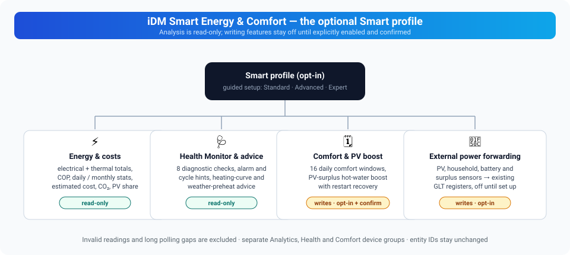

# iDM Smart Energy & Comfort

The integration can run as a slim **Vanilla** integration or with the optional
**iDM Smart Energy & Comfort** feature profile.

<p align="center">
  
</p>

This guide covers **0.18.0**.

| Feature | Default | Effect on the heat pump |
|---------|---------|-------------------------|
| Smart profile | On | Adds analysis and boost controls; analysis alone does not write |
| Health Monitor | Off | Read-only checks and report |
| Heating-curve / weather advice | Off | Read-only recommendations |
| External power forwarding | Off | Writes selected HA values to IDM GLT inputs |
| Automatic PV surplus DHW charging | Off | Starts the DHW boost when enabled and eligible |
| Comfort schedule | Off | Writes and conditionally restores circuit room targets |

Forwarding, automatic DHW charging and scheduling are separate options. Turning
on Smart or choosing Expert mode does not turn these write features on.

## Vanilla

Vanilla exposes the core IDM Modbus and web entities. It keeps the integration
compact and does not create additional calculated analysis entities.

## iDM Smart Energy & Comfort

This profile adds local calculated sensors, compressor runtime and cycle
analysis, short-cycle diagnostics, persistent electrical and thermal energy
statistics, COP statistics, and safe domestic-hot-water boost controls. The
analysis is read-only. It does not stop the compressor or change the heating
curve.

## Activation

Open **Settings → Devices & services → IDM Heatpump → Reconfigure → Features**.
Choose Standard, Advanced or Expert, select the **Feature profile** category
and choose either:

- **iDM Smart Energy & Comfort** for the optional features
- **Vanilla** for the core IDM entities only

All setup depths offer the same functions. Advanced and Expert expose more
tuning options; existing values from a deeper mode remain saved. Select the
additional categories you need, follow their pages, then confirm to save.

Saving reloads the integration. Core entity IDs remain unchanged. Disabling
Smart, Health or an adviser removes its optional entity registrations;
re-enabling it recreates its entities with the same IDs. Device hierarchy is
optional: Analytics, Health Monitor, Comfort and Diagnostics have distinct
groups when it is enabled.

## Persistent energy statistics

When the required IDM power registers are available, Smart adds total, daily
and monthly electrical and thermal energy sensors, plus total, daily and
monthly COP sensors. Values are integrated only from finite, non-negative power
readings and are stored across Home Assistant restarts. Long polling gaps and
invalid readings are excluded instead of being estimated.

Both electrical and thermal power registers must provide valid samples.
Counters resume with new valid intervals after a gap; they do not reconstruct
energy consumed while Home Assistant was offline. Daily and monthly periods
follow the Home Assistant timezone and reset on the next observed snapshot.
In beta 6, the daily PV estimate resets with the other daily values, and the
power registers remain in the polling plan even if their raw entities are
disabled. Lifetime totals are retained across period changes.

The same statistics provide optional estimated electricity costs, CO₂
emissions and PV self-consumption by the heat pump. The electricity price and
emission factor are local Config Flow values. An optional Home Assistant sensor
with a price in EUR/kWh, €/kWh or ct/kWh can supply a changing tariff. Each
observed interval is priced at the current value; intervals with an invalid or
unavailable price remain unpriced while their energy is still counted. The
old fixed-price estimate is preserved when an existing installation switches
to the sensor. PV self-consumption is calculated only when a PV-production source
is selected in the external power mapping. It is an estimate capped by the
heat pump's electrical energy and the selected PV production, not a measured
allocation of solar energy: household loads and battery flows are not deducted.
Cost defaults to EUR 0.30/kWh and the emission factor to 350 g CO₂/kWh;
configure values appropriate to your installation. Negative tariffs and
prices above EUR 5/kWh are treated as invalid by the current implementation.

Analytics entities are placed in a separate **iDM Analytics** device group when
device hierarchy is enabled. This keeps the main heat-pump device focused on
controller values and does not change entity IDs.

## Optional PV surplus DHW automation

The **automatic PV surplus DHW charging** option is disabled by default. It
uses the selected external power sensors and only starts the existing
transactional DHW boost with a temporary DHW setpoint only. The automatic
boost leaves the system mode unchanged, so room heating remains available.
The manual boost still selects hot-water-only mode. Neither path changes the
heating curve or the electric heater settings.

Requirements:

- Smart profile is active.
- The external power source mapping contains either a PV-surplus sensor or PV
  production and house-consumption sensors.
- A battery SOC sensor can optionally enforce a minimum battery level.
- The confirmation that Home Assistant is the only DHW controller is enabled.

Without the ownership confirmation the automation never starts. Do not enable
it while Smartfox, openWB or another system controls domestic hot water.
Invalid or unavailable source values fail closed. Minimum surplus, minimum SOC,
DHW target, maximum duration and cooldown are configurable.

| Setting | Default | Setup depth |
|---------|---------|-------------|
| Minimum surplus | 1.0 kW | Advanced / Expert |
| Minimum battery SOC, when a sensor is selected | 20% | Advanced / Expert |
| DHW target | 55 °C | Advanced / Expert |
| Maximum boost duration | 90 minutes | Expert |
| Cooldown after automatic boost completion | 60 minutes | Expert |

Select the sensors in the external power mapping; the mapping is shared, but
writing those values into GLT registers is separately enabled. Power sources
must declare W, kW or MW. The SOC source accepts a percentage from 0 to 100.
An explicitly selected surplus sensor takes precedence. If it becomes invalid,
the manager does not substitute gross PV production minus house consumption.
Without a surplus source it can derive that difference from two valid,
non-negative power readings.

Power-source fields can be cleared when reconfiguring. Existing values are
suggestions, so removing the battery SOC selection removes that mapping and
its optional HA boost-start condition after reload. Other selected sources
remain mapped. Clearing stops forwarding; it does not overwrite the controller's
last value with a fallback. The controller may retain that value until its own
timeout or another source updates it. Fractional SOC sources are accepted
and rounded to the integer GLT percentage (97.5% becomes 98%); the HA boost
condition uses the original fractional value.

Forwards are event-driven: a sensor update is written within about a second.
Further updates are coalesced without cancelling an active batch. Updates
during an active batch request another pass with the latest source states.
Periodic and event-driven batches cannot interleave.
A periodic fallback cycle runs every 60 seconds by default (the *external
power forwarding interval* option, 30–3600 seconds; the per-register write
cooldown of the integration throttles bursts). Sensor updates arriving during
that cooldown are skipped quietly — nothing is wrong when a source updates
faster than the throttle.

The current wizard opens the source-mapping page through enabled external
power forwarding. Existing mappings remain usable with forwarding off; a
standalone read-only source picker is not currently offered. See
[Configuration](Configuration#external-power-source-mapping-and-forwarding)
before changing a setup that already has an external energy controller.

The manager evaluates about every 30 seconds. Its surplus and SOC checks gate
the **start** of a boost. A later drop in surplus or SOC does not automatically
cancel a boost that is already running; the boost's target, timeout and restore
rules still apply. An automatic boost starts only in Automatic or Hot-water-only
mode, with a successful controller update and a finite DHW temperature at least
5 °C below its target. This fixed reheat hysteresis avoids topping up every
small temperature drop. The full configured cooldown starts when the manager
observes boost completion, cancellation or timeout, even if there is no sun.
Its reservation is persisted before device writes. Reloads and restarts keep
the guard; after recovering an interrupted boost, a full cooldown starts at
the first evaluation. Failed or no-op starts also retain this conservative
guard. The required DHW and mode registers stay polled even with disabled raw
entities.
The exclusive-control checkbox declares ownership; it cannot discover or stop
another controller for you. A transient evaluation error is logged and the
next evaluation is retried.

### Controller PV charging and heating-buffer cycles

External power forwarding is independent of the DHW automation. It mirrors
selected measurements, including signed `pv_surplus`, to the Navigator. These
inputs can activate the **controller's own PV charging of DHW and the heating
buffer**, according to its PV thresholds, storage limits and hysteresis. The
DHW automation cooldown does not inhibit that controller logic. Forwarding
never writes system mode, heating-buffer targets, heating curves or SG-Ready.

Use a net-surplus source with **positive values for export/surplus** and negative
values for grid import; check the inverter sensor's sign convention. Forwarding
preserves its sign and does not convert grid import into surplus. Prefer one
owner for PV charging: the Navigator using forwarded measurements, or the HA
DHW automation using the source mapping with forwarding disabled. Selecting
both is not a shared anti-cycle controller. Review the Navigator's PV heating
buffer settings if the buffer repeatedly charges near its upper limit. The
integration cannot guarantee that DHW and buffer charging use one compressor
cycle; the Navigator owns their sequencing and normal heating demand.

The manager does not control the heating curve or the electric heater. The
optional tariff sensor affects cost accounting only; tariff-controlled heat
pump writes are not enabled.

## SolarEdge battery and multiple inverters over GLT

Use this recipe when HA reads several SolarEdge inverters and the battery, while
the Navigator should receive the site's energy measurements through GLT.
The [SolarEdge instructions currently linked by IDM](https://www.idm-energie.at/wp-content/uploads/2021/04/SolarEdge-DE.pdf)
exclude batteries and multiple inverters from the native connection. Those
instructions are older; check support for the exact controller firmware before
choosing native communication instead.

### Ownership and source selection

1. In the Navigator, select **Building management system / Smartfox** as the PV
   signal. Stop native SolarEdge polling and other writers to the same GLT inputs.
2. Select every inverter that belongs to the same site and grid meter. Do not
   aggregate unrelated installations or both a total sensor and its components.
3. Identify the inverter connected to the battery. Check battery status and the
   direction of SOC movement to confirm the power sign; do not infer it from a name.
4. Confirm the grid-meter sign using an observed import/export period. The
   generator requires an explicit sign choice for both battery and grid.
5. Use instantaneous power sources in **W**, not energy counters in kWh. Convert
   kW sources into separate W helpers first. Use a battery SOC source in percent.

### Generate the HA templates

Download or run [generate_solaredge_glt_templates.py](https://github.com/Xerolux/idm-heatpump-hass/blob/main/scripts/generate_solaredge_glt_templates.py).
It uses Python's standard library and generates files without accessing HA or
writing to hardware. Replace the example IDs with your own sources:

```bash
python scripts/generate_solaredge_glt_templates.py --inverter sensor.pv_hybrid_power --inverter sensor.pv_second_power --inverter sensor.pv_third_power --inverter sensor.pv_fourth_power --hybrid-inverter sensor.pv_hybrid_power --battery-power sensor.battery_power --battery-soc sensor.battery_soc --grid-power sensor.grid_power --battery-positive charging --grid-positive export --output solaredge-glt.yaml --mapping-output solaredge-glt-mapping.json
```

The example assumes positive battery power means charging and positive grid
power means export. Change the two sign arguments to match verified readings.
The inverter list can contain any number of inverters, with one battery-connected
hybrid inverter. Duplicate or overlapping input IDs are rejected. Multiple
batteries or hybrid inverters require a separately validated aggregate; this
generator does not infer their topology.

Review the YAML and merge its sensor block into your existing `template:`
configuration; do not create duplicate top-level keys. Check the HA configuration,
reload template entities or restart HA, and inspect the generated sensors.
Existing names can cause HA to assign a different entity ID: verify the actual
IDs before applying the mapping. The JSON is a configuration reference for the
IDM options wizard, **not** a file to paste into HA's `.storage` directory.
Output files are not overwritten. They contain your selected entity IDs; review
them before sharing.

### Calculations and failure behavior

| Generated measurement | Calculation / behavior |
|---|---|
| Inverter power | Sum of currently valid W-valued AC inverter sources |
| PV production | Sum of valid non-hybrid generation plus the hybrid AC power minus normalized battery discharge, clamped at zero per contribution |
| House consumption | Available inverter AC sum minus normalized grid export, clamped at zero |
| PV surplus | Grid export minus any battery discharge, clamped at zero; missing grid/battery data or all inverters offline produces zero |
| Battery discharge | Positive for discharge, negative for charging |
| Inverters available | Count of valid W-valued inverter sources |

An unavailable inverter is omitted and rejoins automatically when its source
becomes valid. If the hybrid inverter or its battery power is unavailable, its
PV contribution is omitted while the other inverters keep contributing.
No valid inverter makes the inverter/PV/house readings unavailable. A missing
grid reading also makes house consumption unavailable. Invalid or incorrectly
unit-labelled battery power makes the battery reading unavailable. The explicit
zero-surplus helper inhibits new PV charging while HA remains operational;
it does not change the integration's general skip-invalid-source policy.

Partial sums are incomplete estimates, not a full-site measurement. Combining
AC inverter power with DC battery power also introduces conversion-loss and
sampling-time error. Prefer independently measured PV and consumption totals
where available and validated. This recipe does not provide a controller-side
watchdog if HA or the network stops: the Navigator may retain the last values.
Its timeout behavior must be verified separately; do not claim a fully fail-safe
installation from these templates alone.

### Configure and validate forwarding

In IDM options, enable **External power forwarding**, choose a 30-second fallback
interval, and use the generated mapping as the source-selection reference.
Select **as is** for battery sign because the generated battery helper already
normalizes it. SOC uses the original percentage sensor and is rounded by the
integration. Leave electric-heater power unmapped unless it is independently
measured. Forwarding feeds the Navigator's PV controller; keep the separate
HA automatic DHW manager disabled for this recipe. The mapping reference records
that ownership choice explicitly.

Compare all five forwarded measurements with the Navigator, including battery
SOC and discharge. Read-back from the device is stronger evidence than an
optimistic HA entity state immediately after a write. Verify charging and
discharging, an inverter dropout and recovery, and missing grid/battery data.
Watch the availability count to identify a partial sum. A short successful test
does not establish long-term reliability. The battery-display report #493 on
older firmware remains distinct from the fixed forwarding cancellation race.

## Comfort schedule and read-only advisers

The optional comfort schedule can write selected room-temperature targets on
configured heating circuits during up to 16 non-overlapping daily time windows.
The multiline option accepts `circuit,HH:MM,HH:MM,target` per line, for example
`a,06:00,09:00,21.0`; leaving it empty retains the original single window.

For example, with circuits A and D enabled:

```text
a,06:00,09:00,21.0
a,17:00,22:00,22.0
d,22:00,05:00,20.0
```

These are daily windows in **Home Assistant's configured timezone**, not the
server's operating-system timezone. Each end time is exclusive; overnight
windows are supported. Use plain `HH:MM` without a timezone suffix and a
finite target from 15 to 30 °C. Windows must not overlap on the same circuit;
different circuits may run concurrently. Weekday and holiday rules are not
part of this scheduler. The default single window is circuit A, 06:00–22:00,
21 °C; it takes effect only after you enable and confirm the schedule.

It is disabled by
default and requires the explicit confirmation that Home Assistant is the only
controller for that circuit. It restores the previous target after the window
and does not overwrite a manual change made while the schedule was active.
The previous target is persisted before the first write, so it can be restored
after a Home Assistant restart if the scheduled value is still present.

Evaluation runs about once per minute, so a boundary is not an exact-second
trigger. In beta 6, invalid current setpoints cannot arm a new schedule, and
an active scheduler keeps its setpoint in the polling plan even if the raw
setpoint entity is disabled. Manual overrides are respected by comparing the
observed target with the last scheduled value; they are not an ownership lock
against another automation.

The heating-curve assistant and weather-preheat adviser are read-only. They
create recommendations only; they never write a setpoint. The heating-curve
adviser compares the current flow temperature with the circuit setpoint. The
weather adviser requests the selected Home Assistant weather entity's hourly
forecast and reports when a valid forecast within six hours falls below the
configured threshold. Without a usable forecast it is unavailable.

These entities are grouped separately under **iDM Comfort** when device
hierarchy is enabled.

## Optional iDM Health Monitor

The **iDM Health Monitor** is disabled by default and adds read-only diagnostic
entities. It checks communication failures, unusual compressor start
frequency, unusually low current COP, a clearly missed DHW target,
implausible temperature values, and a defrost cycle longer than 45 minutes.
The health-report sensor exposes `ok` or
`problem` and lists active checks in its attributes. It does not change any
heat-pump setting and does not replace a technician diagnosis.

The eight checks are communication failures, frequent compressor starts, low
instantaneous COP, DHW below target, implausible temperatures, long defrost,
shortening compressor cycles and repeated alarm transitions. A low-COP flag
can appear briefly during compressor startup, and a DHW-below-target flag can
appear before normal reheating. These snapshot checks do not by themselves
prove a fault. The report lists which checks are active; unavailable input data
must also be considered when interpreting the result.

Health entities are placed under their own **iDM Health Monitor** device group
when device hierarchy is enabled. This is a diagnostic grouping only and does
not imply that the integration can replace an installer inspection.

The report summary can be copied from the entity attributes or supplemented by
Home Assistant's standard **Download diagnostics** action. That export includes
a structured `installer_report` with operation counts and durations, selected
temperatures, fault register readings, energy totals, health checks and loaded
versions. It intentionally
contains no host, PIN, serial number or other connection secret. It is a
structured snapshot for an installer, not a replacement for a service report.
It does not predict future failures. A conservative trend check compares the
last five completed compressor cycles with fifteen earlier cycles on the same
installation; it reports unusually short recent cycles only after twenty
observed cycles. This is a local anomaly hint, not a failure probability.
The downloaded diagnostics include the installed integration,
`idm-heatpump-api`, `modbus-connection`, `tmodbus`, Home Assistant and Python
versions. See [Troubleshooting](Troubleshooting#smart-features-and-beta-upgrades)
if entities or source readings are missing.

## Experimental AI adviser (upcoming)

The experimental adviser provides daily/weekly reports and explanations of health and efficiency. It is off by default and has no plant control tools or voice exposure. Ollama is local; v0.17.2-b10 adds separately consented OpenAI and Z.ai reports with bounded requests. See [setup, report actions, data coverage and limitations](Experimental-AI-Adviser).
